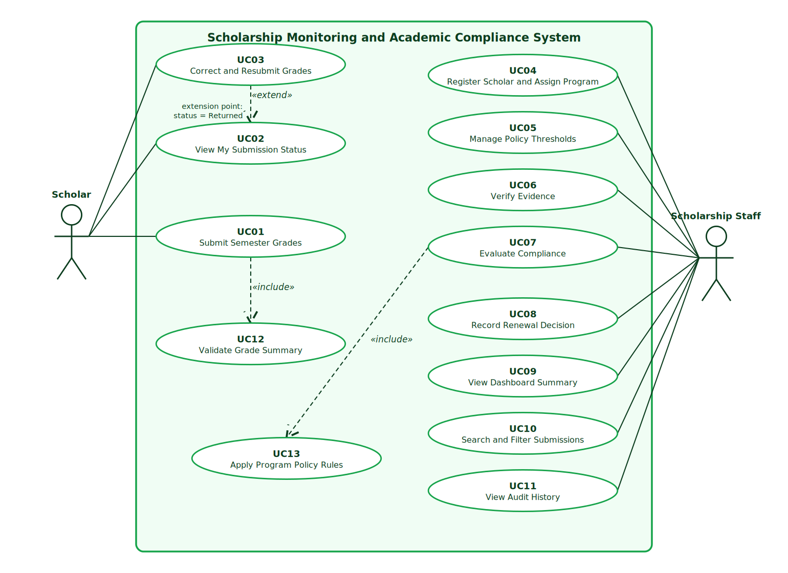
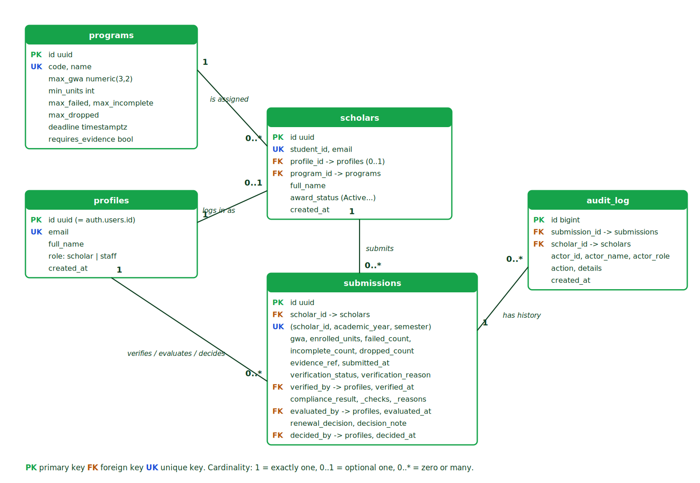

# Part I - Analysis and Design

**Systems Analysis and Design | Laboratory Examination Section B**
**Student Scholarship Monitoring and Academic Compliance System**

Name: ______________________  Student ID: ____________  Program and year: ____________  Date: ____________

> IDs used throughout: **FR** functional requirement, **NFR** non-functional requirement, **BR** business rule, **UC** use case, **TC** test case.

---

## A1. Investigation and planning (6 pts)

### Problem statement
The Scholarship Office manages Excellence Scholar and Access Scholar grants with spreadsheets, e-mail attachments, and paper grade records. Scholars can enter the same semester twice, grades reach staff without being checked against a document, deadlines pass without a reliable time record, and each staff member may apply the thresholds differently. Renewal decisions are slow and inconsistent, and scholars cannot see whether their submission was received, verified, or returned. The Office needs a browser-based system where scholars submit semester summaries with a grade-document reference, and staff verify evidence, evaluate compliance against stored program policy, and record a renewal decision with a reason. The Registrar stays the source of official grades.

### Problem, cause, effect

| # | Problem | Cause | Effect |
|---|---------|-------|--------|
| 1 | Duplicate semester entries | Records live in several spreadsheets and e-mails with no unique key per scholar, year, and semester | Conflicting records, double counting, and extra reconciliation work |
| 2 | Unverified grades | No required evidence reference or verification step before evaluation | Renewal may rest on wrong or unsupported grades |
| 3 | Missed or inconsistently treated deadlines | No system timestamp and no single deadline rule | Late submissions go unnoticed or are judged differently by different staff |
| 4 | Inconsistent scholarship decisions and no scholar visibility | Thresholds differ by program and are applied by hand; no status shown to scholars | Unfair renewals, delays, and repeated follow-up questions |

### Scope and exclusions
**In scope:** Scholar and Scholarship Staff roles; scholar registration and program assignment; two persisted policy records; semester grade submission with validation and duplicate prevention; evidence verification and correction; policy-based compliance evaluation with reasons; explicit renewal decisions; dashboard, search, and filters; audit history; backend-enforced role access.
**Exclusions:** live Registrar API, SMS or e-mail gateway, machine learning, payment or stipend release, full appeal workflow, policy exceptions, and any change to official grades.

### Development tasks
1. Create schema, keys, policy records, test accounts, and role-based access rules (Row Level Security).
2. Build scholar assignment and semester grade submission with validation and duplicate rejection.
3. Build verification and correction workflow, then program-based evaluation and renewal decisions.
4. Build dashboard, search, filters, and history; seed six test records; run TC01 to TC10 and package evidence.

### Risks and responses
| Risk | Response |
|------|----------|
| Network or hosting failure during the exam | Project runs locally with `npm run dev`; README lists run steps; hosted URL is optional |
| Role access done only in the interface and bypassed through the API | Access enforced by database RLS and RPC functions; verified by TC08 run as a real scholar session |

---

## A2. Stakeholders and elicitation (4 pts)

| Stakeholder | Interest | Actor in the system? |
|-------------|----------|----------------------|
| Scholar | Submit grades, see status, correct returned evidence | **Yes (actor)** |
| Scholarship Staff | Verify evidence, evaluate policy, decide renewal, report | **Yes (actor)** |
| Registrar | Keeps official grades; source for cross-checking | No (external stakeholder, no live integration) |
| Scholarship Office head / sponsor | Owns policy thresholds and reporting needs | No in this MVP (policy edited by staff; head consumes the dashboard) |

### Elicitation questions (open-ended)
1. **Verification:** Walk me through how you currently check that a scholar's grades are real. What do you look at, and what makes you send something back?
2. **Verification:** How should a scholar learn that a record was returned, and what should happen after they correct it?
3. **Deadlines:** How do you decide whether a submission is on time, and what happens in practice when one arrives late?
4. **Policy exceptions:** What situations make you want to treat a scholar differently from the written policy, and who decides?
5. **Access:** Who should see which records, and what should a scholar never be able to see or change?
6. **Reports:** What numbers do you report each semester, and how do you want to search or filter the records to prepare them?

---

## A3. Requirements and business rules (10 pts)

### Functional requirements
| ID | Requirement (testable) |
|----|------------------------|
| FR01 | The system shall require sign-in and assign each user exactly one role, Scholar or Staff. Unauthenticated requests return no data. |
| FR02 | A signed-in scholar shall read only their own scholar record, submissions, and history. Staff shall read all synthetic records. This is enforced by the database. |
| FR03 | Staff shall register a scholar (student ID, name, e-mail) and assign exactly one of the two program policy records. |
| FR04 | Compliance thresholds (maximum GWA, minimum units, allowed failed, incomplete, dropped, deadline) shall be read from the assigned program record in the database. Staff can edit them. |
| FR05 | A scholar shall submit academic year, semester, GWA, enrolled units, failed, incomplete and dropped counts, and a grade-document reference. The system records the submission timestamp. |
| FR06 | The system shall reject GWA outside 1.00 to 5.00, negative or non-integer counts, a blank document reference, and a second submission for the same scholar, academic year, and semester, each with a clear message. |
| FR07 | Staff shall mark evidence Verified or Returned (reason required). A scholar can correct a Returned record; the correction returns it to Pending verification. Each change is logged with actor and time. |
| FR08 | Staff shall evaluate only Verified submissions. The result is Compliant or With Deficiency, showing each policy check and specific reasons. The evaluation is logged. |
| FR09 | Staff shall record Approved or Held with a note. Approved requires a Compliant evaluation. Scholars cannot record or change decisions. Each decision is logged. |
| FR10 | The dashboard shall show total assigned scholars, pending verification, compliant, and with deficiency for the selected semester; staff can search by student ID or name and filter by program or compliance. |

### Non-functional requirements (measurable)
| ID | Requirement |
|----|-------------|
| NFR01 | Dashboard load, search, and filter shall respond within 3 seconds with 100 submissions on a normal broadband connection. |
| NFR02 | After a browser refresh, 100% of saved scholars, submissions, decisions, and history entries shall still be present (stored in Supabase Postgres). |
| NFR03 | A scholar session shall return 0 rows belonging to other scholars from any table, and no service-role key or password shall appear in source code or the browser bundle. |
| NFR04 | A scholar shall be able to complete a grade submission in under 2 minutes using one form with no more than 8 inputs; screens shall be usable at 360 px width. |

### Business rules
| ID | Rule |
|----|------|
| BR01 | **Role access:** Scholars see and submit only their own records. Only Staff verify, evaluate, assign programs, edit policy, and decide renewal. |
| BR02 | **Verification gate:** Only Verified submissions with a grade-document reference can be evaluated. Missing or unverified evidence blocks evaluation and renewal. |
| BR03 | **Policy selection and checks:** Each scholar has one program. Excellence: GWA <= 2.00, units >= 18, failed 0, incomplete 0, dropped 0. Access: GWA <= 2.50, units >= 15, failed 0, incomplete 0, dropped <= 1. GWA scale: 1.00 best, 3.00 passing, 5.00 failing; smaller is better. |
| BR04 | **Duplicate prevention:** One submission per scholar, academic year, and semester (unique key). |
| BR05 | **Deadline:** 2026-11-06 17:00 Asia/Manila. A submission at the exact deadline is on time; any later time is late. |
| BR06 | **Renewal authority and separate statuses:** Staff explicitly decide renewal; a deficient record can only be Held. Submission status, academic compliance, and award status are separate; an evaluation flag never disqualifies a scholar automatically. |

---

## A4. UML use case model (8 pts)

*(Editable vector version: `diagrams/usecase.svg`.)*

Authentication is treated as a **precondition** of every use case, not as an include relationship.

| ID | User goal | Actor |
|----|-----------|-------|
| UC01 | Submit Semester Grades | Scholar |
| UC02 | View My Submission Status | Scholar |
| UC03 | Correct and Resubmit Grades | Scholar |
| UC04 | Register Scholar and Assign Program | Staff |
| UC05 | Manage Policy Thresholds | Staff |
| UC06 | Verify Evidence | Staff |
| UC07 | Evaluate Compliance | Staff |
| UC08 | Record Renewal Decision | Staff |
| UC09 | View Dashboard Summary | Staff |
| UC10 | Search and Filter Submissions | Staff |
| UC11 | View Audit History | Staff |
| UC12 | Validate Grade Summary | (supporting, included) |
| UC13 | Apply Program Policy Rules | (supporting, included) |

### Relationship justification
- **UC01 include UC12 (Validate Grade Summary):** every submission must always pass the same validation (GWA range, non-negative integers, document reference, duplicate check). It is mandatory reused behavior, so it is an include. The arrow points from UC01 to UC12.
- **UC07 include UC13 (Apply Program Policy Rules):** every evaluation must always read the scholar's program thresholds and check each rule. Without it the evaluation has no meaning, so it is mandatory reused behavior. The arrow points from UC07 to UC13.
- **UC03 extend UC02 (extension point: status = Returned):** while viewing a submission status, correcting and resubmitting is offered only when staff returned the record. It is conditional added behavior at a defined extension point, so it is an extend. The arrow points from UC03 to the base use case UC02.

---

## A5. Detailed use cases and data design (8 pts)

### UC01 Submit Semester Grades
| Item | Description |
|------|-------------|
| Actor | Scholar |
| Trigger | The scholar opens "Submit semester grades" and chooses to send a new semester summary. |
| Preconditions | Scholar is signed in and registered with a program (authentication is a precondition). No submission exists yet for the chosen academic year and semester. |
| Main flow | 1. Scholar selects academic year and semester. 2. Scholar enters GWA, enrolled units, failed, incomplete, and dropped counts. 3. Scholar enters the grade-document reference. 4. Scholar selects **Submit grades**. 5. System validates the input (includes UC12). 6. System checks that no submission exists for the same scholar, year, and semester. 7. System stores the submission with a server timestamp, status Pending verification, compliance Not Evaluated, renewal Pending. 8. System writes a history entry and shows the receipt time to the scholar. |
| Alternative flows | A1 (step 2): The scholar corrects a Returned record instead; see UC03 (extends UC02). |
| Exception flows | E1 (step 5): GWA outside 1.00 to 5.00, a negative or non-integer count, or a blank reference. The system rejects the form, names the field, and stores nothing. E2 (step 6): Duplicate semester. The system rejects it with a message pointing to My submissions. E3: Scholar not registered. The system explains that staff must register the scholar's e-mail. |
| Postcondition | One new submission exists, Pending verification, with timestamp and history entry. Official grades are untouched. |
| Linked IDs | FR05, FR06, FR02; BR01, BR04, BR05 |

### UC07 Evaluate Compliance
| Item | Description |
|------|-------------|
| Actor | Scholarship Staff |
| Trigger | Staff open a submission from the dashboard and select **Run evaluation**. |
| Preconditions | Staff signed in. The submission is Verified and has a grade-document reference. The scholar is assigned to a program. |
| Main flow | 1. Staff select a Verified submission. 2. Staff select **Run evaluation**. 3. System loads the scholar's program record (includes UC13). 4. System compares GWA, enrolled units, failed, incomplete, and dropped counts with the program thresholds. 5. System compares the submission timestamp with the deadline in Manila time (exact deadline is on time). 6. System sets the result to Compliant when all checks pass, otherwise With Deficiency with one specific reason per failed check. 7. System stores the checks, reasons, evaluator, and time, and writes a history entry. 8. System displays the check table and reasons. |
| Alternative flows | A1 (step 2): Staff re-run after a policy edit; the new result replaces the old one and any earlier renewal decision resets to Pending. |
| Exception flows | E1 (step 1): Evidence is Pending or Returned. The system blocks evaluation with a clear message (BR02). E2: A scholar tries to call evaluation. The database denies it. |
| Postcondition | The submission holds a stored compliance result and reasons. Submission status and award status are unchanged; no automatic disqualification occurs. |
| Linked IDs | FR08, FR04, FR02; BR02, BR03, BR05, BR06 |

### Entity relationship diagram

*(Editable vector version: `diagrams/erd.svg`. Implemented in `supabase/01_schema.sql`.)*

| Entity | Purpose | Key attributes |
|--------|---------|----------------|
| programs | Persisted policy records | id (PK), code, name, max_gwa, min_units, max_failed, max_incomplete, max_dropped, deadline |
| profiles | User profile and role | id (PK = auth user id), email, full_name, role |
| scholars | Scholar assignment | id (PK), student_id (unique), email, profile_id (FK, optional), program_id (FK), award_status |
| submissions | Semester submission, verification, compliance, renewal | id (PK), scholar_id (FK), academic_year, semester, unique (scholar_id, academic_year, semester), gwa, enrolled_units, failed/incomplete/dropped counts, evidence_ref, submitted_at, verification_status, compliance_result, renewal_decision |
| audit_log | Evaluation and decision history | id (PK), submission_id (FK), scholar_id (FK), actor, action, details, created_at |

Cardinalities: one program has zero or many scholars; one profile links to zero or one scholar; one scholar has zero or many submissions (at most one per term); one submission has zero or many history entries; one profile verifies, evaluates, or decides zero or many submissions.

---

## A6. Traceability (4 pts)

| FR | Actor | Use case | Business rule | Implemented screen or function | Test and expected result |
|----|-------|----------|---------------|--------------------------------|--------------------------|
| FR02 | Scholar, Staff | UC02, UC10 | BR01 | Row Level Security policies in `01_schema.sql`; `ScholarPortal` vs `StaffPortal` | **TC08:** scholar reads only their own row and verification is denied by the backend |
| FR06 | Scholar | UC01 (include UC12) | BR04 | Submit form validation in `validate.js`; functions `submit_grades`, `_validate_summary`; unique key `uq_scholar_term` | **TC07:** duplicate semester, GWA 0.50, and negative count are rejected with clear messages |
| FR08 | Staff | UC07 (include UC13) | BR02, BR03, BR05 | Review window, button "Run evaluation"; function `evaluate_submission` | **TC01 to TC06:** B01 Compliant, B02 GWA reason, B03 Compliant, B04 units and incomplete, B05 failed and late, B06 blocked |
| FR09 | Staff | UC08 | BR06 | Review window, "Save decision"; function `decide_renewal` | **TC10:** approve compliant B01, deficient B04 can only be Held, scholar denied |
| FR07 | Staff, Scholar | UC06, UC03 | BR02 | Review window "Return to scholar"; "Correct and resubmit"; functions `verify_submission`, `resubmit_grades` | **TC09:** returned record corrected, shows Pending verification, history kept after refresh |

**Planned requirements not implemented:** none of FR01 to FR10 was left out. Known limitations (stated honestly): evidence is a reference only (no file upload); lateness of a corrected record is measured from the original submission time; staff accounts are granted by SQL, not through the interface. *(Update this paragraph after your own test run if any defect remains.)*
